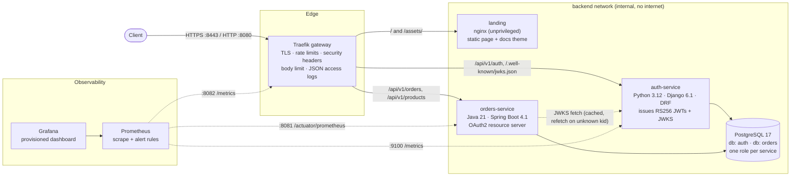

<picture>
  <source media="(prefers-color-scheme: dark)" srcset="docs/images/hero-dark.svg">
  
</picture>

# Secure Cloud Microservices Platform

[](https://github.com/Arya-9989/secure-cloud-microservices-platform/actions/workflows/ci.yml)

A small but production-shaped microservices platform: a **Python identity service** issues RS256 JWTs, a **Java resource server** validates them offline against a JWKS, and a **Traefik gateway** is the only way in. It ships with Prometheus and Grafana, structured logs correlated by request ID, a GitHub Actions pipeline (plus a Jenkinsfile), image scanning, Kubernetes manifests, and a black-box test suite that runs the whole stack.

The platform is deliberately small. The interesting part is the engineering around the services: token lifecycle, authorization boundaries, supply-chain hygiene, and tests that exercise real tokens across language boundaries.

The stack opens on a landing page at the gateway root. It explains the security model and probes the public endpoints live from your browser. Both API references share its theme.

<picture>
  <source media="(prefers-color-scheme: dark)" srcset="docs/screenshots/landing-dark.png">
  
</picture>

| Auth API reference | Orders API reference |
|---|---|
|  |  |

## Contents

[Architecture](#architecture) · [Services](#services) · [Security model](#security-model) · [Tech stack](#tech-stack) · [Quickstart](#quickstart) · [Configuration](#configuration) · [API overview](#api-overview) · [Observability](#observability) · [CI/CD](#cicd) · [Testing](#testing) · [Kubernetes](#deploying-to-kubernetes) · [Project structure](#project-structure) · [Design decisions](#design-decisions) · [Roadmap](#roadmap-future-work)

## Architecture



Only the gateway is published on all interfaces. Prometheus and Grafana bind to `127.0.0.1`. The services and the database sit on an `internal: true` Docker network, and metrics and health ports are never routed through the gateway.

### Authentication flow

```mermaid
sequenceDiagram
    autonumber
    actor C as Client
    participant G as Gateway
    participant A as auth-service
    participant O as orders-service
    participant DB as PostgreSQL

    C->>G: POST /api/v1/auth/token/ {email, password}
    G->>A: forward (+ X-Request-ID)
    A->>A: per-IP + per-account rate limit, Argon2 verify
    A->>DB: store SHA-256(refresh token), new session family
    A-->>C: access_token (RS256, 15 min) + opaque refresh_token

    C->>G: GET /api/v1/orders (Authorization: Bearer ...)
    G->>O: forward
    O->>A: GET /.well-known/jwks.json (first use or unknown kid only)
    O->>O: verify RS256 signature, iss, aud, exp, sub; map scope/roles
    O->>DB: SELECT ... WHERE customer_id = token.sub
    O-->>C: 200 orders

    C->>A: POST /api/v1/auth/token/refresh/ {refresh_token}
    A->>DB: lock token row, mark ROTATED, issue successor in same family
    A-->>C: new access_token + new refresh_token

    Note over C,A: Replaying an already-rotated refresh token is treated as theft
    C->>A: POST /api/v1/auth/token/refresh/ {old refresh_token}
    A->>DB: revoke every token in the family
    A-->>C: 401 (legitimate holder must log in again)
```

## Services

| Component | Stack | Responsibility | Ports (container) |
|---|---|---|---|
| **auth-service** | Python 3.12, Django 6.1, DRF 3.18, PyJWT, Argon2, gunicorn | Registration, login, RS256 access tokens, rotating refresh tokens, JWKS, user administration | 8000 API · 9100 metrics |
| **orders-service** | Java 21, Spring Boot 4.1, Spring Security 7, JPA/Hibernate 7, Flyway | Product catalog and orders; OAuth2 resource server enforcing scopes, roles and ownership | 8080 API · 8081 management |
| **landing** | nginx 1.30 (unprivileged, Alpine) | Static landing page at `/` and the shared theme for both API references. No server-side code; strict CSP with Trusted Types | 8080 (internal only) |
| **gateway** | Traefik 3.7 (file provider, no Docker socket) | Single entry point, TLS, routing, rate limiting, headers, access logs | 8080 HTTP · 8443 HTTPS · 8082 metrics |
| **postgres** | PostgreSQL 17 | Separate database and least-privilege role per service | 5432 (internal only) |
| **prometheus** / **grafana** | Prometheus 3.15, Grafana 13.2 | Metrics, alert rules, provisioned dashboard | 9090 / 3000 (localhost only) |

## Security model

| Threat / concern | Control | Where |
|---|---|---|
| Token forgery, `alg=none`, HS256/RS256 key confusion | Only RS256 accepted. The key is chosen by `kid` from our own key set, never from the token. Tests forge each variant | `accounts/tokens.py`, `JwtDecoderConfig.java`, both test suites |
| Tokens for another API or issuer | `iss` and `aud` validated on both sides; `sub`, `exp`, `iat`, `jti` required | same |
| Stolen refresh token | Opaque, single-use, stored only as SHA-256. A replay revokes the whole session family. Sessions have a 30-day absolute lifetime | `accounts/tokens.py` |
| Credential stuffing / brute force | Two independent throttles (per client IP and per target account) share the DB cache across workers. Edge rate limits too. Failures look identical and use timing-safe hashing | `accounts/throttles.py`, `gateway/dynamic/routes.yml` |
| Password storage | Argon2id, minimum 12 characters, common and numeric password validators | `auth_service/settings.py` |
| Privilege escalation | Role is never client-settable. The admin API needs scope `users:admin`. The orders admin API needs both `ROLE_ADMIN` and `SCOPE_orders:admin`. Unmatched routes are `denyAll` | `SecurityConfig.java`, `accounts/views.py` |
| IDOR / data leakage | Ownership is part of the SQL query, so another user's order returns **404, not 403** | `OrderRepository.java` |
| Price tampering | Clients send SKU and quantity only. Prices come from the server catalog, and unknown JSON fields are rejected | `OrderService.java`, `application.yml` |
| Stale privileges after disable / demotion | Changing a role or deactivating an account revokes every refresh token immediately. Access tokens expire within 15 minutes | `AdminUserDetailView` |
| Signing key exposure | The key never lives in the repo or image. It is generated into a volume (`0600`) locally and mounted from a Secret in K8s. `kid` is the RFC 7638 thumbprint, and extra public keys can be published for rotation | `accounts/keys.py`, `ensure_signing_key` |
| Secrets in source | None. `scripts/init_env.py` generates `.env` locally (git-ignored), and the services refuse to start without required secrets | `.env.example`, `settings.py` |
| Container breakout / lateral movement | Non-root users, read-only root filesystems, all capabilities dropped, `no-new-privileges`, distroless JVM image. K8s adds restricted Pod Security and default-deny NetworkPolicies | Dockerfiles, `compose.yaml`, `deploy/k8s/` |
| Vulnerable dependencies | `pip-audit` on locked Python deps. Trivy fails CI on fixable HIGH/CRITICAL in either image (OS and language packages). Dependabot keeps everything current | `.github/workflows/ci.yml` |
| Script injection in browser-facing pages | No inline script or style anywhere. The landing page sends `default-src 'none'` with `script-src 'self'` and `require-trusted-types-for 'script'`, and writes to the DOM through `textContent` only. Both Swagger UI pages run under `script-src 'self'` without `'unsafe-inline'`: their bootstrap scripts are files and every asset is self-hosted | `services/landing/`, `auth_service/settings.py`, `SecurityConfig.java` |
| Transport | HTTPS entry point (TLS 1.2+, AEAD ciphers) with HSTS. HTTP→HTTPS redirect is a one-line production switch | `gateway/` |

Errors on both services, including 401 and 403, are [RFC 9457](https://www.rfc-editor.org/rfc/rfc9457) `application/problem+json` documents carrying the `request_id`. The orders service also publishes [RFC 9728](https://www.rfc-editor.org/rfc/rfc9728) protected-resource metadata, which it advertises in `WWW-Authenticate`.

## Tech stack

- **Python:** 3.12, Django 6.1, Django REST framework, PyJWT + cryptography, argon2-cffi, psycopg 3, gunicorn, drf-spectacular. Tooling: uv (locked), ruff, mypy `--strict`, pytest, pip-audit.
- **Java:** 21, Spring Boot 4.1 (Spring Framework 7, Spring Security 7), Hibernate 7, Flyway, Micrometer, springdoc-openapi. Tooling: Maven wrapper, Spotless (google-java-format), `-Werror`, JUnit 5, Testcontainers.
- **Platform:** Docker (multi-stage, non-root, distroless JVM runtime), Docker Compose, Traefik, PostgreSQL, Prometheus, Grafana, Kustomize.
- **Web:** hand-written HTML, CSS and one small script, served by unprivileged nginx. Inter and JetBrains Mono are self-hosted (SIL Open Font License). Each service self-hosts its Swagger UI assets.
- **Delivery:** GitHub Actions (SHA-pinned), Jenkins, Trivy, GHCR, Dependabot, kubeconform.

## Quickstart

Prerequisites: Docker with Compose v2, and Python 3.9+ for the helper scripts. Running the test suites outside CI also needs [uv](https://docs.astral.sh/uv/) and, for the Java service, nothing beyond a JDK 21+ (the Maven wrapper downloads Maven).

```bash
git clone https://github.com/Arya-9989/secure-cloud-microservices-platform.git
cd secure-cloud-microservices-platform

python scripts/init_env.py                 # writes .env with random secrets (git-ignored)
docker compose up --build --wait           # ~2-3 min on first build
```

| URL | What |
|---|---|
| http://localhost:8080/ | Landing page: architecture, security model and live endpoint probes |
| http://localhost:8080/docs/auth/ | Auth service Swagger UI |
| http://localhost:8080/docs/orders/swagger-ui.html | Orders service Swagger UI |
| https://localhost:8443 | Same routes over TLS (self-signed locally) |
| http://localhost:3000 | Grafana (user `admin`, password `GRAFANA_ADMIN_PASSWORD` in `.env`) |
| http://localhost:9090 | Prometheus (targets, alert rules) |

Try it:

```bash
# Register, log in, and place an order through the gateway
curl -s -X POST localhost:8080/api/v1/auth/register/ -H 'Content-Type: application/json' \
  -d '{"email":"ada@example.com","password":"correct-horse-battery-staple"}'

TOKEN=$(curl -s -X POST localhost:8080/api/v1/auth/token/ -H 'Content-Type: application/json' \
  -d '{"email":"ada@example.com","password":"correct-horse-battery-staple"}' \
  | python -c 'import json,sys; print(json.load(sys.stdin)["access_token"])')

curl -s localhost:8080/api/v1/products -H "Authorization: Bearer $TOKEN"
curl -s -X POST localhost:8080/api/v1/orders -H "Authorization: Bearer $TOKEN" \
  -H 'Content-Type: application/json' -d '{"lines":[{"sku":"KB-001","quantity":2}]}'
```

Fill the dashboard with realistic traffic, run the end-to-end suite, and tear everything down:

```bash
python scripts/demo_traffic.py --duration 120
cd tests/e2e && uv run pytest -v && cd -
docker compose down --volumes
```

## Configuration

All configuration comes from environment variables. In the compose setup they come from `.env` (see [`.env.example`](.env.example)), and in Kubernetes from ConfigMaps and Secrets. Defaults are secure: debug is off, there are no fallback secrets, and the services refuse to start when a required value is missing.

| Variable | Service | Default | Purpose |
|---|---|---|---|
| `DJANGO_SECRET_KEY` | auth | **required** | Django signing secret (≥ 32 chars) |
| `DATABASE_URL` | auth | **required** | e.g. `postgres://auth:…@postgres:5432/auth` |
| `JWT_PRIVATE_KEY_FILE` | auth | `/keys/jwt-private-key.pem` | RSA signing key (PKCS#8 PEM, ≥ 2048 bit) |
| `JWT_ADDITIONAL_PUBLIC_KEY_FILES` | auth | – | Comma-separated public keys kept in the JWKS during rotation |
| `JWT_ISSUER` / `JWT_AUDIENCE` | both | `urn:secure-platform:auth-service` / `secure-platform-api` | Must match between issuer and resource servers |
| `ACCESS_TOKEN_TTL_SECONDS` | auth | `900` | Access token lifetime |
| `REFRESH_TOKEN_TTL_SECONDS` / `REFRESH_SESSION_MAX_SECONDS` | auth | 7 days / 30 days | Sliding and absolute session lifetime |
| `LOGIN_RATE_PER_IP` / `LOGIN_RATE_PER_ACCOUNT` | auth | `20/min` / `5/min` | Brute-force throttles (compose relaxes the per-IP limit locally) |
| `REGISTER_RATE_PER_IP` | auth | `10/hour` | Sign-up throttle |
| `TRUSTED_PROXY_COUNT` | auth | `0` | Number of proxies whose `X-Forwarded-For` is trusted |
| `API_DOCS_ENABLED` | auth | `true` | Serve Swagger UI / OpenAPI (disabled in the K8s manifests) |
| `SPRING_DATASOURCE_URL` / `_USERNAME` / `_PASSWORD` | orders | localhost / `orders` / *(none)* | PostgreSQL connection |
| `PLATFORM_SECURITY_JWK_SET_URI` | orders | `http://auth-service:8000/.well-known/jwks.json` | Where to fetch verification keys |
| `PLATFORM_SECURITY_CLOCK_SKEW` | orders | `30s` | Tolerated clock drift |
| `AUTH_BOOTSTRAP_ADMIN_EMAIL` / `_PASSWORD` | auth-init | – | Creates the first administrator (idempotent) |

## API overview

All routes go through the gateway. Full schemas are in the Swagger UIs listed above.

| Method & path | Auth | Description |
|---|---|---|
| `POST /api/v1/auth/register/` | public, rate limited | Create a customer account (role `USER`) |
| `POST /api/v1/auth/token/` | public, rate limited | Log in → `access_token`, `refresh_token`, `expires_in`, `scope` |
| `POST /api/v1/auth/token/refresh/` | refresh token | Rotate. Replaying an old token revokes the session |
| `POST /api/v1/auth/logout/` | refresh token | Revoke the session (always `204`) |
| `GET /api/v1/auth/me/` | bearer | The caller's profile and scopes |
| `GET /.well-known/jwks.json` | public | RFC 7517 key set (`Cache-Control: max-age=300`) |
| `GET /api/v1/admin/users/` · `PATCH /api/v1/admin/users/{id}/` | `users:admin` | List users; change role / disable (revokes sessions) |
| `GET /api/v1/products` | `orders:read` | Active catalog |
| `POST /api/v1/orders` | `orders:write` | Place an order, priced server-side → `201` + `Location` |
| `GET /api/v1/orders` · `GET /api/v1/orders/{id}` | `orders:read` | The caller's orders (paginated) / one order (404 if not yours) |
| `POST /api/v1/orders/{id}/cancel` | `orders:write` | Cancel while `PENDING` (else `409`) |
| `GET /api/v1/admin/orders?status=` | `ROLE_ADMIN` + `orders:admin` | All orders |
| `PATCH /api/v1/admin/orders/{id}/status` | `ROLE_ADMIN` + `orders:admin` | Lifecycle `PENDING → CONFIRMED → SHIPPED → DELIVERED` (or `CANCELLED`); invalid moves → `409` |
| `GET /.well-known/oauth-protected-resource` | public | RFC 9728 metadata for the orders API |

Roles map to scopes in one place ([`ROLE_SCOPES`](services/auth-service/accounts/models.py)). `USER` gets `orders:read orders:write`, and `ADMIN` additionally gets `orders:admin users:admin`.

## Observability

- **Metrics:** Both services export the same `http_server_requests_seconds{method,uri,status}` histogram: Micrometer on the JVM, and a matching hand-rolled metric in Python. One PromQL query therefore covers every service. Gunicorn runs several worker processes, so auth-service aggregates them with prometheus_client's multiprocess mode and serves the result from the gunicorn master on an internal port. Business and security metrics include `auth_login_attempts_total{outcome}`, `auth_tokens_issued_total{grant_type}`, `auth_refresh_token_reuse_detected_total` and `orders_placed_total`.
- **Dashboard:** The provisioned Grafana dashboard ([JSON](observability/grafana/dashboards/platform-overview.json)) has four rows:
  - golden signals: targets up, gateway throughput, 5xx ratio, slowest p95, logins and orders in the last hour
  - traffic and latency: requests and p95/p99 latency per service, gateway responses by status class (429s split out), errors by service
  - security events: login outcomes, token grants, refresh-token replays
  - runtime and edge: JVM heap, connection pool, gateway p95 per backend

  Every panel has a description and a fixed unit. Each service keeps one colour on every panel (auth-service blue, orders-service orange, gateway green, landing amber). Status colours are reserved for status, such as 2xx, 4xx, 429 and 5xx or login outcomes. Stat tiles stay neutral until they cross the matching alert threshold.


<sub>Provisioned Grafana dashboard after running `scripts/demo_traffic.py`. Refresh-token replays and throttled logins are generated on purpose.</sub>

- **Alerts:** [Prometheus rules](observability/prometheus/alerts.yml) cover target down, 5xx ratio > 5 %, p95 > 1 s, refresh-token replay and sustained failed logins. They are visible under Prometheus → Alerts. Routing them to a pager is listed as future work.
- **Logs:** Every component writes one JSON object per line with a shared schema (`@timestamp`, `level`, `logger_name`, `message`, `service`, `request_id`, `user_id`). Each request produces exactly one access-log line with route, status and duration.
- **Correlation:** A client-supplied `X-Request-ID` (validated: 8–128 safe characters) is kept, and otherwise one is generated. The ID is echoed in the response, attached to every log line and problem response, and recorded by the gateway access log. The `Authorization` header is redacted there.

```text
gateway  {"RequestPath":"/api/v1/products","OriginStatus":200,"request_X-Request-Id":"smoke-test-0001","request_Authorization":"REDACTED",...}
orders   {"message":"GET /api/v1/products 200","request_id":"smoke-test-0001","user_id":"b3f39626-…","duration_ms":395.4,"service":"orders-service",...}
```

## CI/CD

[`.github/workflows/ci.yml`](.github/workflows/ci.yml) runs on every push and pull request. All actions are pinned to commit SHAs, and each job gets least-privilege token permissions.

| Job | What it proves |
|---|---|
| `auth-service` | Locked install, ruff, `mypy --strict`, pytest with coverage **against PostgreSQL**, `pip-audit`, image build, Trivy scan |
| `landing` | Script syntax check, image build (runs `nginx -t`), Trivy scan |
| `orders-service` | Spotless, `-Werror` compile, JUnit + Testcontainers (real PostgreSQL), image build, Trivy scan |
| `platform-config` | `kustomize` + `kubeconform -strict`, compose validation, lint/type-check of e2e tests and scripts |
| `e2e` | `docker compose up --wait` of the full stack, then the black-box suite through the gateway; logs dumped on failure |
| `publish` (main only) | Pushes both images to GHCR with branch and immutable `sha-` tags, provenance and SBOM attestations |

Trivy fails the build on any **fixable HIGH/CRITICAL** vulnerability in the OS or language packages of all three images. No ignore list is needed today.

A [`Jenkinsfile`](Jenkinsfile) implements the same stages with Docker agents for teams that run Jenkins. Its e2e stage reuses the exact images that were scanned. [Dependabot](.github/dependabot.yml) proposes weekly updates for uv, Maven, Docker, Compose and Actions.

## Testing

| Suite | Count | Run | Highlights |
|---|---|---|---|
| auth-service | 79 unit/API tests, 96 % line coverage | `cd services/auth-service && uv run pytest` | RFC 7638 test vector, alg-none / HS256 confusion / foreign-key forgery, rotation + replay, absolute session expiry, throttling, admin authorization, log schema, migrations in sync |
| orders-service | 49 JUnit tests | `cd services/orders-service && ./mvnw verify` | Full authorization matrix, real RS256 tokens against a JWKS stub (expired, wrong iss/aud, missing sub, HS256, unsigned, foreign key), **key rotation without restart**, ownership 404s, state machine, Flyway on real PostgreSQL |
| end-to-end | 28 black-box tests | `cd tests/e2e && uv run pytest` (stack running) | Cross-service token verification, forged tokens, per-account throttling, session revocation, correlation IDs, HTTPS/HSTS, docs routing, landing page and docs under strict CSP, Prometheus targets and series, Grafana provisioning, edge 429s |

## Deploying to Kubernetes

[`deploy/k8s/`](deploy/k8s) is a Kustomize base for the API tier. The landing page and the API docs belong to the compose stack only (`API_DOCS_ENABLED` is `false` in the manifests). PostgreSQL is assumed to be a managed service, and the cluster is assumed to run a Traefik ingress controller.

```bash
kubectl create namespace secure-platform
kubectl -n secure-platform create secret generic auth-service-secrets \
  --from-literal=DJANGO_SECRET_KEY="$(openssl rand -base64 48)" \
  --from-literal=DATABASE_URL='postgres://auth:…@db.example.internal:5432/auth' \
  --from-literal=AUTH_BOOTSTRAP_ADMIN_EMAIL=admin@example.com \
  --from-literal=AUTH_BOOTSTRAP_ADMIN_PASSWORD='…'
kubectl -n secure-platform create secret generic auth-signing-key \
  --from-file=jwt-private-key.pem=./jwt-private-key.pem
kubectl -n secure-platform create secret generic orders-service-secrets \
  --from-literal=SPRING_DATASOURCE_URL='jdbc:postgresql://db.example.internal:5432/orders' \
  --from-literal=SPRING_DATASOURCE_USERNAME=orders --from-literal=SPRING_DATASOURCE_PASSWORD='…'
kubectl apply -k deploy/k8s
```

What the manifests include:
- restricted Pod Security admission
- non-root, read-only, capability-free containers
- startup, liveness and readiness probes
- resource requests and limits, PDBs, CPU-based HPAs and topology spread
- a one-off migration Job, so replicas never race on Django migrations; Flyway already uses an advisory lock
- default-deny NetworkPolicies with explicit allows (ingress → services, orders → auth JWKS, monitoring → metrics ports, DNS, database)
- a TLS Ingress

CI validates them with `kubeconform -strict`. They have not been applied to a live cluster as part of this repository's checks.

## Project structure

```text
.
├── services/
│   ├── auth-service/            # Django + DRF identity service
│   │   ├── accounts/            #   users, tokens, keys/JWKS, throttles, views, commands
│   │   ├── platform_core/       #   env config, JSON logging, request IDs, metrics, health
│   │   ├── auth_service/        #   settings, urls, wsgi
│   │   ├── tests/               #   pytest suite
│   │   ├── gunicorn.conf.py     #   workers + multiprocess metrics server
│   │   └── Dockerfile, pyproject.toml, uv.lock
│   ├── landing/                 # static landing page + shared docs theme (nginx)
│   └── orders-service/          # Spring Boot resource server
│       ├── src/main/java/…/     #   config (security, JWT), catalog, order, web
│       ├── src/main/resources/  #   application.yml, Flyway migrations
│       ├── src/test/java/…/     #   WebMvc authz matrix, Testcontainers integration
│       └── Dockerfile, pom.xml, mvnw
├── gateway/                     # Traefik static + dynamic (routes, TLS) config
├── observability/               # Prometheus config + alerts, Grafana provisioning + dashboard
├── deploy/
│   ├── k8s/                     # Kustomize manifests
│   └── postgres/                # per-service database bootstrap
├── tests/e2e/                   # black-box suite against the compose stack
├── scripts/                     # init_env.py (secrets), demo_traffic.py
├── docs/                        # README hero (images/) and screenshots/
├── compose.yaml
├── Jenkinsfile
└── .github/                     # CI workflow, Dependabot
```

## Design decisions

- **Offline JWT validation over gateway forward-auth.** Resource servers verify signatures locally against a cached JWKS, so the auth service is not on the hot path of every request and is not a single point of failure for reads. The cost is that a disabled account keeps a valid access token until it expires. That is why tokens last 15 minutes and refresh tokens are revoked immediately.
- **Opaque, rotating refresh tokens instead of JWT refresh tokens.** Refresh tokens need server-side state anyway (revocation, reuse detection). Opaque random tokens stored as hashes make that state authoritative and keep a database leak harmless.
- **`kid` = RFC 7638 thumbprint.** The key ID is derived from the key itself, so it can't drift from the key material, and rotation is "publish the new key, switch signing, retire the old key after max TTL".
- **Scopes for APIs, roles for people.** The auth service maps roles to scopes in one table. Resource servers authorize on scopes and add a role check only where defence in depth is worth it (admin APIs).
- **One histogram schema across languages.** Matching Micrometer's metric and label names in Python means dashboards and alerts don't care which language a service is written in.
- **Database-backed throttle cache.** Login throttles must be shared across gunicorn workers and replicas. Using the existing PostgreSQL avoids adding Redis just for counters; login is low-volume enough for this.
- **Traefik with the file provider.** Routes are reviewed as code, and the gateway never gets the Docker socket, which is effectively root on the host.
- **Spring Boot 4.1 rather than 3.5.** Boot 3.5 left OSS support in June 2026. Its Spring Framework 6.2 line has CRITICAL CVEs with fixes only in 7.x, so upgrading was the way to keep the Trivy gate strict without an ignore list.
- **The landing page is its own static service.** It explains the whole platform, so it should not live inside one API, and a separate unprivileged nginx container keeps its strict CSP (Trusted Types, no inline code) independent of the APIs. The live probes call only public endpoints through the gateway; health and metrics ports stay unrouted. The shared docs theme is served from the same place, and without it the docs fall back to stock Swagger UI.
- **Monorepo.** Contracts that span services (token claims, metrics schema, gateway routes, e2e tests) change atomically in one pull request.

## Roadmap (future work)

These are **not implemented** yet:

- Distributed tracing with OpenTelemetry (gateway → services → database) exported to Tempo or Jaeger.
- Alertmanager routing for the existing alert rules.
- OAuth2 client-credentials grant for service-to-service calls, and DPoP / mTLS-bound access tokens.
- Signing keys in a KMS/HSM, with automated rotation driven by `JWT_ADDITIONAL_PUBLIC_KEY_FILES`.
- Idempotency keys for `POST /api/v1/orders`.
- Image signing with cosign and admission-time verification; a Helm chart or Argo CD application for GitOps delivery.
- Load tests (k6) with latency SLOs enforced in CI.

## License

[MIT](LICENSE)
