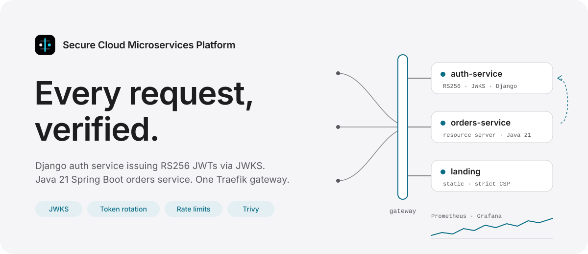
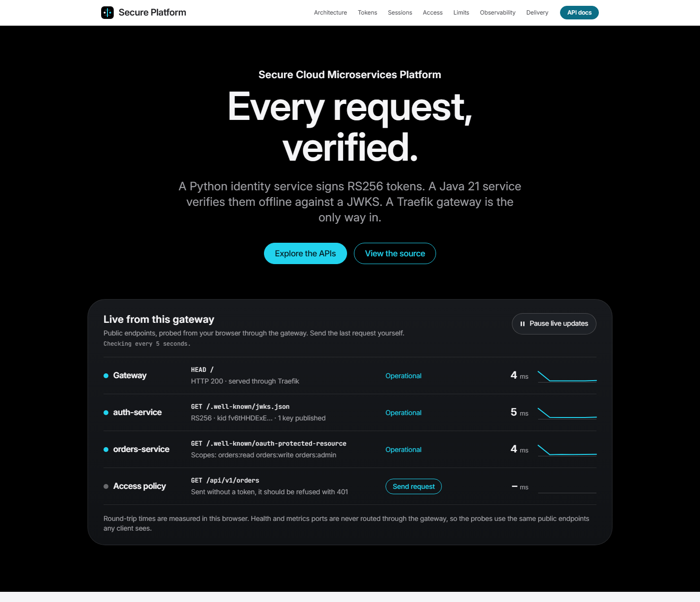
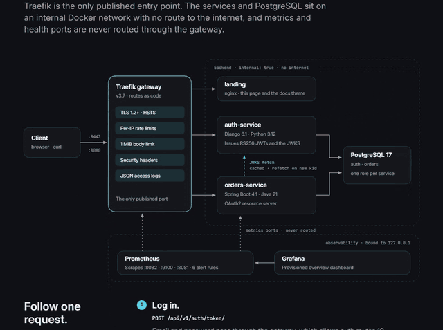
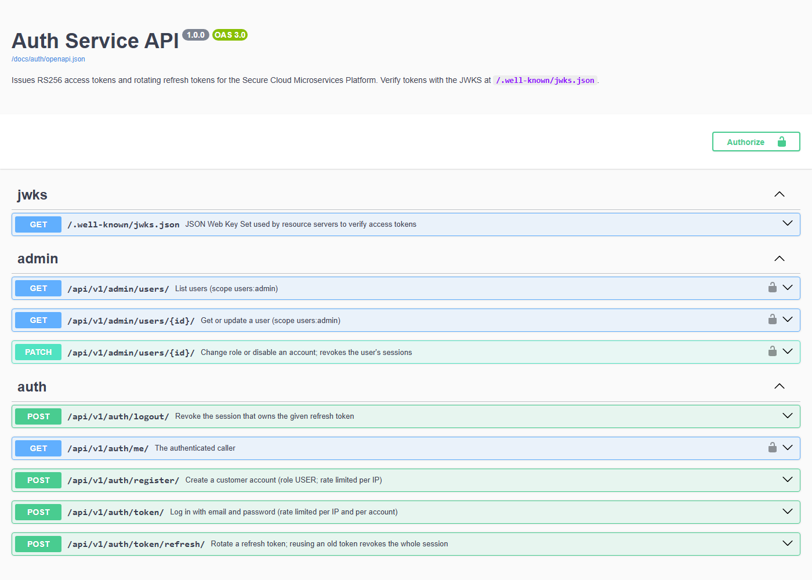
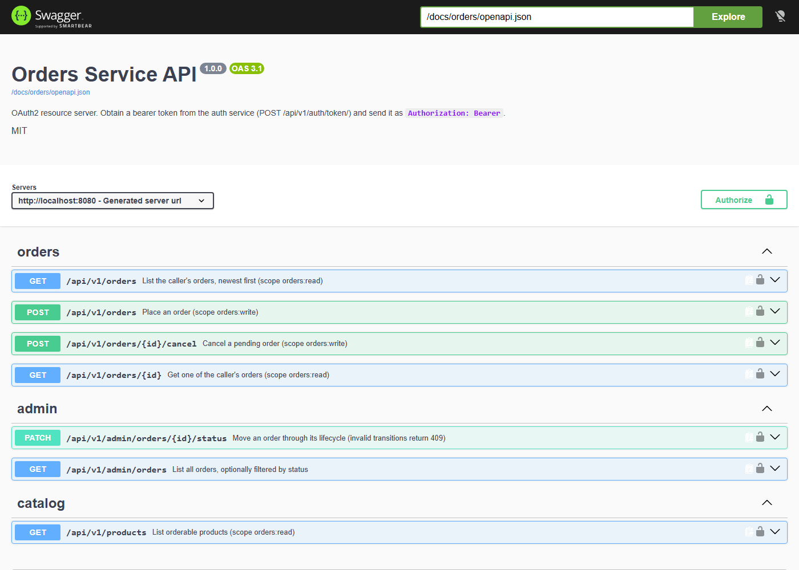
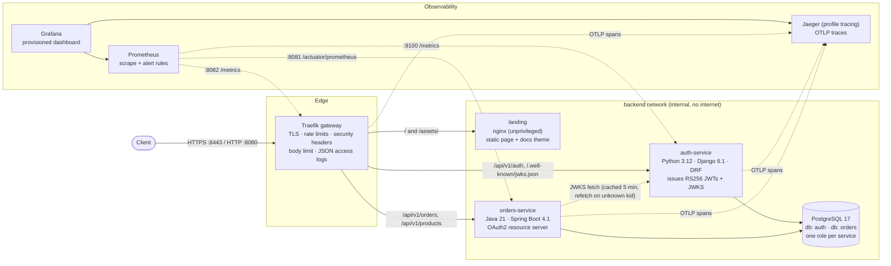
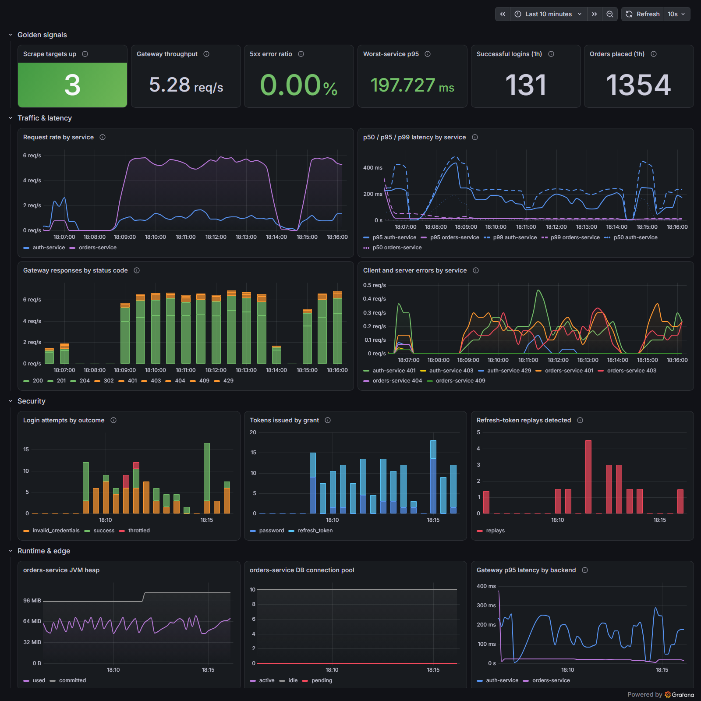

<picture>
  <source media="(prefers-color-scheme: dark)" srcset="docs/images/hero-dark.svg">
  
</picture>

# Secure Cloud Microservices Platform

[](https://github.com/Arya-9989/secure-cloud-microservices-platform/actions/workflows/ci.yml)

A small but production-shaped microservices platform: a **Python identity service** issues RS256 JWTs, a **Java resource server** validates them offline against a JWKS, and a **Traefik gateway** is the only way in. It ships with OpenTelemetry tracing (Jaeger), Prometheus, Alertmanager and Grafana, structured logs correlated by request and trace ID, a GitHub Actions pipeline (plus a Jenkinsfile), image scanning, keyless image signing with admission-time verification, latency SLOs enforced by k6, Kubernetes manifests with a matching Helm chart and Argo CD, and a black-box test suite that runs the whole stack. Services call each other with DPoP-bound client-credentials tokens, and signing keys can live in Vault with rotation that never breaks a token. Design decisions are in [docs/adr](docs/adr).

The platform is deliberately small. The interesting part is the engineering around the services: token lifecycle, authorization boundaries, supply-chain hygiene, and tests that exercise real tokens across language boundaries.

The stack opens on a landing page at the gateway root. It explains the security model and probes the public endpoints live from your browser. Both API references share its theme.

<picture>
  <source media="(prefers-color-scheme: dark)" srcset="docs/screenshots/landing-dark.png">
  
</picture>

Scrolling the architecture section walks one request through the diagram: log in, RS256 token issued, JWKS fetched, token verified at orders-service, and `401` for the same request without a token. The motion is CSS scroll-driven (with a small IntersectionObserver fallback), runs under the page's strict CSP, and is skipped under reduced motion, where the diagram and all five steps are shown at once. The console's sparklines slide as samples arrive, and a failed probe leaves a red tick in the history.



| Auth API reference | Orders API reference |
|---|---|
|  |  |

## Contents

[Architecture](#architecture) · [Services](#services) · [Security model](#security-model) · [Tech stack](#tech-stack) · [Quickstart](#quickstart) · [Configuration](#configuration) · [API overview](#api-overview) · [Observability](#observability) · [CI/CD](#cicd) · [Testing](#testing) · [Kubernetes](#deploying-to-kubernetes) · [Project structure](#project-structure) · [Design decisions](#design-decisions) · [Roadmap](#roadmap-future-work)

## Architecture



Only the gateway is published on all interfaces. Prometheus and Grafana bind to `127.0.0.1`. The services and the database sit on an `internal: true` Docker network, and metrics and health ports are never routed through the gateway.

### Authentication flow

```mermaid
sequenceDiagram
    autonumber
    actor C as Client
    participant G as Gateway
    participant A as auth-service
    participant O as orders-service
    participant DB as PostgreSQL

    C->>G: POST /api/v1/auth/token/ {email, password}
    G->>A: forward (+ X-Request-ID)
    A->>A: per-IP + per-account rate limit, Argon2 verify
    A->>DB: store SHA-256(refresh token), new session family
    A-->>C: access_token (RS256, 15 min) + opaque refresh_token

    C->>G: GET /api/v1/orders (Authorization: Bearer ...)
    G->>O: forward
    O->>A: GET /.well-known/jwks.json (cache miss: first use, after 5 min, or unknown kid)
    O->>O: verify RS256 signature, iss, aud, exp, sub; map scope/roles
    O->>DB: SELECT ... WHERE customer_id = token.sub
    O-->>C: 200 orders

    C->>A: POST /api/v1/auth/token/refresh/ {refresh_token}
    A->>DB: lock token row, mark ROTATED, issue successor in same family
    A-->>C: new access_token + new refresh_token

    Note over C,A: Replaying an already-rotated refresh token is treated as theft
    C->>A: POST /api/v1/auth/token/refresh/ {old refresh_token}
    A->>DB: revoke every token in the family
    A-->>C: 401 (legitimate holder must log in again)
```

## Services

| Component | Stack | Responsibility | Ports (container) |
|---|---|---|---|
| **auth-service** | Python 3.12, Django 6.1, DRF 3.18, PyJWT, Argon2, gunicorn | Registration, login, RS256 access tokens, rotating refresh tokens, JWKS, user administration | 8000 API · 9100 metrics |
| **orders-service** | Java 21, Spring Boot 4.1, Spring Security 7, JPA/Hibernate 7, Flyway | Product catalog and orders; OAuth2 resource server enforcing scopes, roles and ownership | 8080 API · 8081 management |
| **landing** | nginx 1.30 (unprivileged, Alpine) | Static landing page at `/` and the shared theme for both API references. No server-side code; strict CSP with Trusted Types | 8080 (internal only) |
| **gateway** | Traefik 3.7 (file provider, no Docker socket) | Single entry point, TLS, routing, rate limiting, headers, access logs | 8080 HTTP · 8443 HTTPS · 8082 metrics |
| **postgres** | PostgreSQL 17 | Separate database and least-privilege role per service | 5432 (internal only) |
| **prometheus** / **grafana** | Prometheus 3.15, Grafana 13.2 | Metrics, alert rules, provisioned dashboard | 9090 / 3000 (localhost only) |
| **alertmanager** / **alert-sink** | Alertmanager 0.34, a standard-library Python receiver | Routes alerts by severity and category; the sink records what is delivered (local stand-in for a pager) | 9093 / 9097 (localhost only) |
| **jaeger** (profile `tracing`) | Jaeger 2.20 (in-memory) | Distributed traces over OTLP/HTTP, Grafana datasource | 16686 UI (localhost only) |

## Security model

| Threat / concern | Control | Where |
|---|---|---|
| Token forgery, `alg=none`, HS256/RS256 key confusion | Only RS256 accepted. The key is chosen by `kid` from our own key set, never from the token. Tests forge each variant | `accounts/tokens.py`, `JwtDecoderConfig.java`, both test suites |
| Tokens for another API or issuer | `iss`, `aud`, `exp` and `sub` validated on both sides; auth-service also requires `iat` and `jti` | same |
| Stolen refresh token | Opaque, single-use, stored only as SHA-256. A replay revokes the whole session family. Rotation, replay revocation and logout lock the family first, so a racing rotation cannot keep a live token. Sessions have a 30-day absolute lifetime | `accounts/tokens.py` |
| Credential stuffing / brute force | Two independent throttles (per client IP and per target account) share the DB cache across workers. Edge rate limits too, at the compose gateway and the Kubernetes ingress. Failures look identical and use timing-safe hashing | `accounts/throttles.py`, `gateway/dynamic/routes.yml`, `deploy/k8s/middlewares.yaml` |
| Password storage | Argon2id, minimum 12 characters, common and numeric password validators | `auth_service/settings.py` |
| Privilege escalation | Role is never client-settable. The admin API needs scope `users:admin`. The orders admin API needs both `ROLE_ADMIN` and `SCOPE_orders:admin`. Unmatched routes are `denyAll` | `SecurityConfig.java`, `accounts/views.py` |
| IDOR / data leakage | Ownership is part of the SQL query, so another user's order returns **404, not 403** | `OrderRepository.java` |
| Duplicate orders on retry, cross-customer key probing | Optional `Idempotency-Key`, scoped per customer, claimed under the primary key in the order's transaction; a reused key with a different request is `422` | `idempotency/`, `V3__idempotency_keys.sql` |
| Price tampering | Clients send SKU and quantity only. Prices come from the server catalog, and unknown JSON fields are rejected | `OrderService.java`, `application.yml` |
| Machine credentials that leak | Service tokens are DPoP-bound (useless without the client's private key), short-lived (5 min), audience-restricted to one resource and limited to client scopes. The secret is stored as an Argon2 hash, and secret guessing is throttled per client and per IP | `accounts/oauth.py`, `accounts/dpop.py`, `dpop/` (orders) |
| Untraceable sensitive changes | Every role and status change, password change, account deletion and service-client change is an append-only `AuditEvent` (actor, target, IP, request id), written in the same transaction as the change and holding no personal data or secrets | `accounts/audit.py`, ADR 0009 |
| A stolen session after a password change | Changing the password revokes every refresh token. Password changes and deletions need the current password and are throttled per account | `PasswordChangeView`, `MeView.delete` |
| Stale privileges after disable / demotion | Changing a role or deactivating an account revokes every refresh token immediately. Access tokens expire within 15 minutes | `AdminUserDetailView` |
| JWKS abuse / auth-service outage | orders-service caches the key set for 5 minutes and refetches on an unknown `kid` at most twice per 10 seconds, so forged key IDs cannot flood auth-service. If auth-service is unreachable, the last good key set keeps verifying for 20 minutes (cache TTL + token lifetime). JWKS requests time out after 2 s; when no keys can be obtained the API answers `503` with `Retry-After`, never `401` or `500` | `JwtDecoderConfig.java` |
| Signing key exposure | The key never lives in the repo or image. With `JWT_SIGNER=vault` it never leaves Vault transit: auth-service sends only the signing input, using a token that can sign but not rotate or export. By default it's a file in a volume (`0600`) locally and a Secret in K8s. `kid` is the RFC 7638 thumbprint | `accounts/keys.py`, `accounts/kms.py`, ADR 0007 |
| Rotation that breaks tokens | New key versions are published before they sign (6 min, longer than any JWKS cache) and old ones stay published until their last token has expired. A timeline test checks that every token stays verifiable for its whole lifetime | `kms.plan_rotation`, `tests/test_kms.py` |
| Secrets in source | None. `scripts/init_env.py` generates `.env` locally (git-ignored), and the services refuse to start without required secrets | `.env.example`, `settings.py` |
| Container breakout / lateral movement | Non-root users, read-only root filesystems, all capabilities dropped, `no-new-privileges`, distroless JVM image. K8s adds restricted Pod Security and default-deny NetworkPolicies | Dockerfiles, `compose.yaml`, `deploy/k8s/` |
| Tampered or foreign images | CI signs each pushed digest keyless (GitHub OIDC → Fulcio, logged in Rekor) and attests its SPDX SBOM. In the cluster, Kyverno admits a pod only when its image carries both, from this repository's `ci.yml` on `main`, and pins the tag to the verified digest. A native admission policy allows no other registry | `.github/workflows/ci.yml`, `deploy/k8s/admission/` |
| Vulnerable dependencies | `pip-audit` on locked Python deps. Trivy fails CI on fixable HIGH/CRITICAL in either image (OS and language packages). Dependabot keeps everything current | `.github/workflows/ci.yml` |
| Script injection in browser-facing pages | No inline script or style anywhere. The landing page sends `default-src 'none'` with `script-src 'self'` and `require-trusted-types-for 'script'`, and writes to the DOM through `textContent` only. Both Swagger UI pages run under `script-src 'self'` without `'unsafe-inline'`: their bootstrap scripts are files and every asset is self-hosted. All three send `Cross-Origin-Opener-Policy: same-origin`, and bearer tokens typed into a Swagger page are not persisted to `localStorage` | `services/landing/`, `auth_service/settings.py`, `SecurityConfig.java` |
| Transport | HTTPS entry point (TLS 1.2+, AEAD ciphers) with HSTS. HTTP→HTTPS redirect is a one-line production switch | `gateway/` |
| Spoofed proxy headers | The gateway deletes header aliases such as `X_Forwarded_For` or `X.Real.Ip`, which a WSGI backend would read as the real `X-Forwarded-For` | `gateway/traefik.yml` |
| Tracing as an attack surface | Services sample only what the gateway sampled, propagate W3C trace context but no baggage, and record neither request headers (except `X-Request-Id`) nor SQL parameter values | `platform_core/tracing.py`, `application.yml`, ADR 0001 |

Errors on both services, including 401 and 403, are [RFC 9457](https://www.rfc-editor.org/rfc/rfc9457) `application/problem+json` documents carrying the `request_id`. The orders service also publishes [RFC 9728](https://www.rfc-editor.org/rfc/rfc9728) protected-resource metadata, which it advertises in `WWW-Authenticate`.

## Tech stack

- **Python:** 3.12, Django 6.1, Django REST framework, PyJWT + cryptography, argon2-cffi, psycopg 3, gunicorn, drf-spectacular. Tooling: uv (locked), ruff, mypy `--strict`, pytest, pip-audit.
- **Java:** 21, Spring Boot 4.1 (Spring Framework 7, Spring Security 7), Hibernate 7, Flyway, Micrometer, springdoc-openapi. Tooling: Maven wrapper, Spotless (google-java-format), `-Werror`, JUnit 5, Testcontainers.
- **Platform:** Docker (multi-stage, non-root, distroless JVM runtime), Docker Compose, Traefik, PostgreSQL, Prometheus, Alertmanager, Grafana, Jaeger (OpenTelemetry), HashiCorp Vault (transit), Kustomize, Helm, Argo CD, Kyverno.
- **Web:** hand-written HTML, CSS and one small script, served by unprivileged nginx. Inter and JetBrains Mono are self-hosted (SIL Open Font License). Each service self-hosts its Swagger UI assets.
- **Delivery:** GitHub Actions (SHA-pinned), Jenkins, Trivy, cosign (keyless) + SBOM attestations, GHCR, Dependabot, kubeconform, k6, kind.

## Quickstart

Prerequisites: Docker with Compose v2, and Python 3.9+ for the helper scripts. Running the test suites outside CI also needs [uv](https://docs.astral.sh/uv/) and, for the Java service, nothing beyond a JDK 21+ (the Maven wrapper downloads Maven).

```bash
git clone https://github.com/Arya-9989/secure-cloud-microservices-platform.git
cd secure-cloud-microservices-platform

python scripts/init_env.py                 # writes .env with random secrets (git-ignored)
docker compose up --build --wait           # ~2-3 min on first build
```

| URL | What |
|---|---|
| http://localhost:8080/ | Landing page: architecture, security model and live endpoint probes |
| http://localhost:8080/docs/auth/ | Auth service Swagger UI |
| http://localhost:8080/docs/orders/swagger-ui.html | Orders service Swagger UI |
| https://localhost:8443 | Same routes over TLS (self-signed locally) |
| http://localhost:3000 | Grafana (user `admin`, password `GRAFANA_ADMIN_PASSWORD` in `.env`) |
| http://localhost:9090 | Prometheus (targets, alert rules) |
| http://localhost:9093 | Alertmanager (active alerts, silences) |
| http://localhost:9097/notifications | Notifications Alertmanager delivered (local receiver) |
| http://localhost:16686 | Jaeger (only with tracing on, see [Tracing](#tracing)) |

Host ports come from `.env` (`GATEWAY_HTTP_PORT`, `GATEWAY_HTTPS_PORT`, `PROMETHEUS_PORT`, `GRAFANA_PORT`, `ALERTMANAGER_PORT`, `ALERT_SINK_PORT`, `JAEGER_PORT`) or the shell environment. `demo_traffic.py` and the end-to-end suite follow the same settings.

Try it:

```bash
# Register, log in, and place an order through the gateway
curl -s -X POST localhost:8080/api/v1/auth/register/ -H 'Content-Type: application/json' \
  -d '{"email":"ada@example.com","password":"correct-horse-battery-staple"}'

TOKEN=$(curl -s -X POST localhost:8080/api/v1/auth/token/ -H 'Content-Type: application/json' \
  -d '{"email":"ada@example.com","password":"correct-horse-battery-staple"}' \
  | python -c 'import json,sys; print(json.load(sys.stdin)["access_token"])')

curl -s localhost:8080/api/v1/products -H "Authorization: Bearer $TOKEN"
curl -s -X POST localhost:8080/api/v1/orders -H "Authorization: Bearer $TOKEN" \
  -H 'Content-Type: application/json' -d '{"lines":[{"sku":"KB-001","quantity":2}]}'
```

Fill the dashboard with realistic traffic, run the end-to-end suite, and tear everything down:

```bash
python scripts/demo_traffic.py --duration 120
cd tests/e2e && uv run pytest -v && cd -
docker compose down --volumes
```

## Configuration

All configuration comes from environment variables. In the compose setup they come from `.env` (see [`.env.example`](.env.example)), and in Kubernetes from ConfigMaps and Secrets. Defaults are secure: debug is off, there are no fallback secrets, and the services refuse to start when a required value is missing.

| Variable | Service | Default | Purpose |
|---|---|---|---|
| `DJANGO_SECRET_KEY` | auth | **required** | Django signing secret (≥ 32 chars) |
| `DATABASE_URL` | auth | **required** | e.g. `postgres://auth:…@postgres:5432/auth` |
| `JWT_PRIVATE_KEY_FILE` | auth | `/keys/jwt-private-key.pem` | RSA signing key (PKCS#8 PEM, ≥ 2048 bit) |
| `JWT_ADDITIONAL_PUBLIC_KEY_FILES` | auth | – (compose: the file key's public half) | Comma-separated public keys kept in the JWKS during rotation or a cut-over to Vault |
| `JWT_SIGNER` | auth | `local` | `local` (PEM file) or `vault` (transit; profile `kms` in compose) |
| `VAULT_ADDR` / `VAULT_TOKEN_FILE` / `JWT_VAULT_KEY` / `JWT_VAULT_MOUNT` | auth | `http://vault:8200` / `/run/secrets/vault-token` / `auth-jwt` / `transit` | Where the transit key lives and the file holding the least-privilege signer token |
| `JWT_KEY_PUBLISH_AHEAD_SECONDS` / `JWT_KEYSET_REFRESH_SECONDS` | auth | `360` / `30` | How long a new key version is published before it signs; how often the key set is re-read |
| `JWT_ISSUER` / `JWT_AUDIENCE` | both | `urn:secure-platform:auth-service` / `secure-platform-api` | Must match between issuer and resource servers |
| `ACCESS_TOKEN_TTL_SECONDS` | auth | `900` | Access token lifetime |
| `REFRESH_TOKEN_TTL_SECONDS` / `REFRESH_SESSION_MAX_SECONDS` | auth | 7 days / 30 days | Sliding and absolute session lifetime |
| `LOGIN_RATE_PER_IP` / `LOGIN_RATE_PER_ACCOUNT` | auth | `20/min` / `5/min` | Brute-force throttles (compose relaxes the per-IP limit locally) |
| `REGISTER_RATE_PER_IP` | auth | `10/hour` | Sign-up throttle |
| `TRUSTED_PROXY_COUNT` | auth | `0` | Number of proxies whose `X-Forwarded-For` is trusted |
| `API_DOCS_ENABLED` | auth | `true` | Serve Swagger UI / OpenAPI (disabled in the K8s manifests) |
| `SPRING_DATASOURCE_URL` / `_USERNAME` / `_PASSWORD` | orders | localhost / `orders` / *(none)* | PostgreSQL connection |
| `PLATFORM_SECURITY_JWK_SET_URI` | orders | `http://auth-service:8000/.well-known/jwks.json` | Where to fetch verification keys |
| `PLATFORM_SECURITY_CLOCK_SKEW` | orders | `30s` | Tolerated clock drift |
| `PLATFORM_SECURITY_JWKS_CACHE_TTL` / `_REFETCH_MIN_INTERVAL` | orders | `5m` / `10s` | Key-set cache lifetime; at most two refetches per interval for unknown `kid`s |
| `PLATFORM_ORDERS_IDEMPOTENCY_TTL` / `_LOCK_TIMEOUT` | orders | `24h` / `5s` | How long idempotency keys are kept; how long a duplicate waits for the first request |
| `PLATFORM_SECURITY_JWKS_OUTAGE_TOLERANCE` / `_TIMEOUT` | orders | `20m` / `2s` | How long the last good key set is used while the JWKS is unreachable; per-request timeout |
| `AUTH_BOOTSTRAP_ADMIN_EMAIL` / `_PASSWORD` | auth-init | – | Creates the first administrator (idempotent) |
| `FULFILMENT_CLIENT_SECRET` | auth-init | **required** in compose | Secret of the `fulfilment` service client (≥ 32 chars, stored hashed) |
| `OAUTH_RESOURCES` / `CLIENT_TOKEN_TTL_SECONDS` | auth | `urn:secure-platform:orders-service` / `300` | Resources clients may request tokens for; service token lifetime |
| `DPOP_PROOF_MAX_AGE_SECONDS` / `DPOP_NONCE_LIFETIME_SECONDS` / `DPOP_REQUIRE_NONCE` | auth | `60` / `300` / `true` | DPoP proof freshness and server nonces at the token endpoint |
| `PLATFORM_SECURITY_RESOURCE` | orders | `urn:secure-platform:orders-service` | This service's resource identifier (the `aud` of service tokens) |
| `PLATFORM_SECURITY_DPOP_NONCE_SECRET` (`DPOP_NONCE_SECRET` in `.env`) | orders | random per instance | base64url HMAC key (≥ 32 bytes) for DPoP nonces; must be shared by all replicas |
| `PLATFORM_SECURITY_DPOP_PROOF_MAX_AGE` / `_NONCE_LIFETIME` / `_REQUIRE_NONCE` | orders | `60s` / `5m` / `true` | DPoP proof checks at the resource server |
| `TRACING_ENABLED` | gateway, auth, orders (compose) | `false` | Distributed tracing; set together with `COMPOSE_PROFILES=tracing` |
| `OTEL_EXPORTER_OTLP_ENDPOINT` / `OTEL_SERVICE_NAME` | auth | `http://jaeger:4318` / `auth-service` | Standard OpenTelemetry settings (all `OTEL_*` variables apply) |
| `MANAGEMENT_TRACING_EXPORT_ENABLED` / `MANAGEMENT_OPENTELEMETRY_TRACING_EXPORT_OTLP_ENDPOINT` | orders | `false` / `http://jaeger:4318/v1/traces` | The same switch and endpoint in Spring Boot's terms |

## API overview

All routes go through the gateway. Full schemas are in the Swagger UIs listed above.

| Method & path | Auth | Description |
|---|---|---|
| `POST /api/v1/auth/register/` | public, rate limited | Create a customer account (role `USER`) |
| `POST /api/v1/auth/token/` | public, rate limited | Log in → `access_token`, `refresh_token`, `expires_in`, `scope` |
| `POST /api/v1/auth/token/refresh/` | refresh token | Rotate. Replaying an old token revokes the session |
| `POST /api/v1/auth/logout/` | refresh token | Revoke the session (always `204`) |
| `GET /api/v1/auth/me/` | bearer | The caller's profile and scopes |
| `POST /api/v1/auth/password/` | bearer + current password | Change the password; every session is signed out (`204`) |
| `DELETE /api/v1/auth/me/` | bearer + password | Delete the account and its sessions (`204`); the last active admin can't |
| `GET /.well-known/jwks.json` | public | RFC 7517 key set (`Cache-Control: max-age=300`) |
| `GET /api/v1/admin/users/?email=&role=&is_active=` · `PATCH /api/v1/admin/users/{id}/` | `users:admin` | Search users; change role / disable (revokes sessions) |
| `GET /api/v1/admin/audit-events/?action=&target_id=` | `users:admin` | Append-only audit trail: role and status changes, password changes, deletions, client provisioning |
| `GET /api/v1/products` | `orders:read` | Active catalog |
| `POST /api/v1/orders` | `orders:write` | Place an order, priced server-side → `201` + `Location`. Optional `Idempotency-Key` makes retries safe (see below) |
| `GET /api/v1/orders` · `GET /api/v1/orders/{id}` | `orders:read` | The caller's orders (paginated) / one order (404 if not yours) |
| `POST /api/v1/orders/{id}/cancel` | `orders:write` | Cancel while `PENDING` (else `409`) |
| `GET /api/v1/admin/orders?status=` | `ROLE_ADMIN` + `orders:admin` | All orders |
| `PATCH /api/v1/admin/orders/{id}/status` | `ROLE_ADMIN` + `orders:admin` | Lifecycle `PENDING → CONFIRMED → SHIPPED → DELIVERED` (or `CANCELLED`); invalid moves → `409` |
| `GET /.well-known/oauth-protected-resource` | public | RFC 9728 metadata for the orders API |
| `POST /api/v1/auth/oauth/token` | client secret (HTTP Basic) + DPoP proof | Client credentials grant for services → a 5-minute DPoP-bound token (see below) |
| `GET /api/v1/fulfilment/orders?status=CONFIRMED` | service token: `orders:fulfil`, DPoP | The warehouse's work queue |
| `PATCH /api/v1/fulfilment/orders/{id}/status` | service token: `orders:fulfil`, DPoP | Mark `SHIPPED` or `DELIVERED`; nothing else (invalid moves → `409`) |

### Idempotent order placement

Send an `Idempotency-Key` (for example a UUID) with `POST /api/v1/orders`, and a retry after a timeout can't place the order twice ([ADR 0003](docs/adr/0003-idempotency-keys.md), following the IETF *Idempotency-Key* draft):

| Situation | Response |
|---|---|
| First request with the key | `201`, the order is placed and the response stored |
| Same key, same request (whitespace and field order don't matter) | The stored `201` again (same order id and `Location`), with `Idempotent-Replayed: true` |
| Same key, different request | `422` |
| Duplicate arriving while the first request is still running | It waits up to 5 s, then `409` with `Retry-After: 1` |
| Malformed key (not 8–128 of `[A-Za-z0-9._:-]`) | `400` |

Keys are scoped to the customer (the token's `sub`) and kept for 24 hours. Only successful responses are stored, so a request that fails validation can be corrected and retried with the same key. Duplicates are serialised by the table's primary key: the key is claimed with `INSERT … ON CONFLICT` in the same transaction that places the order, so a concurrent duplicate waits for the first transaction and then replays its response. Tests fire 8 identical requests at once and assert exactly one order. Expired keys are purged in batches every 10 minutes.

```bash
KEY=$(python -c 'import uuid; print(uuid.uuid4())')
for attempt in 1 2; do
  curl -si -X POST localhost:8080/api/v1/orders -H "Authorization: Bearer $TOKEN" \
    -H "Idempotency-Key: $KEY" -H 'Content-Type: application/json' \
    -d '{"lines":[{"sku":"KB-001","quantity":1}]}' | grep -E '^HTTP|Idempotent-Replayed|"id"'
done
```

Roles map to scopes in one place ([`ROLE_SCOPES`](services/auth-service/accounts/models.py)). `USER` gets `orders:read orders:write`, and `ADMIN` additionally gets `orders:admin users:admin`. Service clients draw from a separate catalogue ([`CLIENT_SCOPES`](services/auth-service/accounts/models.py), today only `orders:fulfil`), so a machine token never carries a person's scopes.

### Signing keys in Vault, with automated rotation

With `JWT_SIGNER=vault`, tokens are signed by Vault's transit engine and the private key never exists in auth-service ([ADR 0007](docs/adr/0007-kms-signing-and-rotation.md)). The signer is an interface (`accounts/kms.py`): the PEM file and Vault implement it today, and the ADR sketches a cloud KMS implementation (AWS KMS needs an account 🔑, so it isn't built).

```bash
# in .env: profiles and signer together
COMPOSE_PROFILES=kms            # or tracing,kms
JWT_SIGNER=vault

docker compose up --build --wait
docker compose exec auth-service python manage.py rotate_signing_key --show
# one line per key version: kid, creation time, and "signing", "published, signs from …"
# or "published until …"
```

- **Rotation is automated and overlap-safe.** Vault rotates the key every 30 days (`auto_rotate_period`), and `rotate_signing_key` rotates on demand (it needs an admin token, because the service's own token can only sign). A new version is published in the JWKS at once but signs only after `JWT_KEY_PUBLISH_AHEAD_SECONDS`. The previous version stays published until every token it signed has expired. So no token issued before a rotation fails verification after it, and no retired key is trusted longer than that.
- **The cut-over from the file key is covered too:** compose always publishes the file key's public half (`JWT_ADDITIONAL_PUBLIC_KEY_FILES`), so switching to Vault doesn't log anyone out.
- **When Vault is down,** the last key set keeps the JWKS (and therefore verification) working, and logins answer `503` with `Retry-After` and a generic message. No half-issued sessions are left behind.
- **Tested** against a real Vault: Vault integration tests (signing, rotation, least privilege, outage, the rotate command), a timeline test of the overlap rule, and an e2e test that rotates mid-run and checks that tokens from before still work at orders-service while new tokens switch keys.

### Service-to-service calls: client credentials with DPoP

A warehouse (fulfilment) system calls orders-service as itself, with no user account and no admin rights ([ADR 0006](docs/adr/0006-client-credentials-and-dpop.md)):

1. It holds a private key (for example EC P-256) and a client secret. It sends `POST /api/v1/auth/oauth/token` with `grant_type=client_credentials`, HTTP Basic credentials and a **DPoP proof** (RFC 9449): a JWT signed with that key over the method and URL. The first attempt is answered `use_dpop_nonce` with a `DPoP-Nonce` header, and the retry carries that nonce.
2. auth-service checks everything about the proof: the signature by the embedded public key, `htm`/`htu`, an `iat` within 60 s, the nonce, and a `jti` it hasn't seen before (shared cache). It then issues a 5-minute token with `aud` = `urn:secure-platform:orders-service`, `client_id`, the scope and `cnf.jkt` (the key's thumbprint). No refresh token.
3. Every call to orders-service sends `Authorization: DPoP <token>` plus a fresh proof, which also binds the token itself (`ath`). orders-service verifies the proof with Spring Security's DPoP support, using a `jti` replay cache in PostgreSQL that every replica shares and its own HMAC nonces (a shared secret, rotating every 5 minutes).

What this buys, and what the tests try:

| Attack | Result |
|---|---|
| A stolen token sent as `Bearer` | `401` (no downgrade from DPoP) |
| A stolen token with the thief's own key | `401` (thumbprint ≠ `cnf.jkt`) |
| A captured proof, replayed | `401` (`jti` already used) |
| A proof for another method, URL or token, or an old one | `401` |
| The client token at the customer, admin or auth APIs | `401` / `403`: it isn't a person and has the wrong audience |
| A people token (even admin) at the fulfilment API | `403` |
| A wrong client secret, or an unknown client | `401 invalid_client`, same timing |
| A DPoP proof presented as an access token | `401` (`typ` must be `JWT`/`at+jwt`) |

mTLS-bound tokens (RFC 8705) were considered and not chosen: TLS ends at the gateway, so the service never sees the client certificate. The ADR explains the trade-off. In compose, `auth-init` creates the `fulfilment` client from `FULFILMENT_CLIENT_SECRET` (`python manage.py ensure_oauth_client`, idempotent), and `tests/e2e/test_service_to_service.py` is a complete client: about 50 lines, PyJWT and cryptography.

## Observability

- **Metrics:** Both services export the same `http_server_requests_seconds{method,uri,status}` histogram: Micrometer on the JVM, and a matching hand-rolled metric in Python. One PromQL query therefore covers every service. Gunicorn runs several worker processes, so auth-service aggregates them with prometheus_client's multiprocess mode and serves the result from the gunicorn master on an internal port. Business and security metrics include `auth_login_attempts_total{outcome}`, `auth_tokens_issued_total{grant_type}`, `auth_refresh_token_reuse_detected_total` and `orders_placed_total`.
- **Dashboard:** The provisioned Grafana dashboard ([JSON](observability/grafana/dashboards/platform-overview.json)) has four rows:
  - golden signals: targets up, gateway throughput, gateway 5xx ratio, slowest p95, successful logins and orders placed in the last hour
  - traffic and latency: requests and p95/p99 latency per service, gateway responses by status class (429s split out), errors each service reports
  - security events: login outcomes, token grants, refresh-token replays
  - runtime and edge: JVM heap, connection pool, gateway p95 per backend

  Every panel has a description and a fixed unit. Gateway figures come from Traefik's router metrics, so they include the `502`/`503` the gateway returns when a service is down, which the service itself cannot report. An end-to-end test runs every panel query against Prometheus and fails on an empty one. Each service keeps one colour on every panel (auth-service blue, orders-service orange, landing aqua; the three pass a colour-vision-deficiency check). Status colours are reserved for status, such as 2xx, 4xx, 429 and 5xx or login outcomes. Stat tiles stay neutral until they cross the matching alert threshold.


<sub>Provisioned Grafana dashboard after running `scripts/demo_traffic.py`. Refresh-token replays and throttled logins are generated on purpose.</sub>

- **Alerts:** six [Prometheus rules](observability/prometheus/alerts.yml) cover target down, a service's own 5xx ratio > 5 %, a route's 5xx ratio at the gateway > 5 % (which includes a service that is down), p95 > 1 s, refresh-token replay and sustained failed logins. Each has a `promtool` unit test ([`alerts.test.yml`](observability/prometheus/alerts.test.yml)). Prometheus sends them to Alertmanager, which routes them ([config](observability/alertmanager/alertmanager.yml), [ADR 0002](docs/adr/0002-alert-routing.md)):

  | Labels | Receiver | Wait / repeat |
  |---|---|---|
  | `category=security` (refresh-token replay, brute force) | `security` | 10 s / 1 h, one notification per alert name |
  | `severity=critical` (target down, gateway 5xx) | `pager` | 10 s / 1 h |
  | anything else | `platform` (team chat) | 30 s / 4 h |

  `TargetDown` inhibits the same job's error-rate and latency warnings, and a critical alert inhibits that job's other warnings. Security alerts are never inhibited, and an alert without a `job` label can't inhibit anything (Alertmanager treats a label missing on both sides as equal). Locally every receiver is a webhook into `alert-sink`, which records each notification at `GET /notifications`. In production, swap in PagerDuty or Slack with `routing_key_file` / `api_url_file` pointing at mounted secrets. `amtool` validates the config and unit-tests the routing tree in CI ([`routes.test.sh`](observability/alertmanager/routes.test.sh)), and the e2e suite replays a refresh token and waits for the page.
- **Logs:** Every component writes one JSON object per line with a shared schema (`@timestamp`, `level`, `logger_name`, `message`, `service`, `request_id`, `user_id`). Each request produces exactly one access-log line with route, status and duration.
- **Correlation:** A client-supplied `X-Request-ID` (validated: 8–128 safe characters) is kept, and otherwise one is generated. The ID is echoed in the response, attached to every log line and problem response, and recorded by the gateway access log. The `Authorization` header is redacted there. With tracing on, every log line also carries `trace_id` and `span_id`.

```text
gateway  {"RequestPath":"/api/v1/products","OriginStatus":200,"request_X-Request-Id":"smoke-test-0001","request_Authorization":"REDACTED",...}
orders   {"message":"GET /api/v1/products 200","request_id":"smoke-test-0001","user_id":"b3f39626-…","duration_ms":395.4,"service":"orders-service",...}
```

### Tracing

OpenTelemetry traces cover every hop: the gateway, the service, each SQL statement and, when orders-service meets an unknown key id, its JWKS fetch and auth-service's handling of it. They are exported over OTLP/HTTP to Jaeger. The design and the trade-offs are in [ADR 0001](docs/adr/0001-distributed-tracing.md).

```bash
# in .env (or the shell): both switches together
COMPOSE_PROFILES=tracing
TRACING_ENABLED=true

docker compose up --build --wait
# Jaeger UI: http://localhost:16686, or Grafana → Explore → Jaeger
```

- **Gateway:** Traefik's OTLP exporter is declared in `gateway/traefik.yml`, and `routes.yml` turns it on per router from `TRACING_ENABLED`. With tracing off, Traefik creates no spans and forwards `traceparent` unchanged.
- **auth-service:** the OpenTelemetry SDK with the Django and psycopg instrumentations, started in each gunicorn worker (`platform_core/tracing.py`).
- **orders-service:** Spring Boot's OpenTelemetry starter, JDBC spans from `datasource-micrometer`, and a JWKS client (`ObservedJwksRetriever`) that injects `traceparent`, so auth-service joins the trace.
- **Sampling:** the gateway decides (`sampleRate`, 1.0 locally). The services follow its decision and never start a trace themselves, so health probes are not traced.
- **What is recorded:** routes, status codes, timings and SQL with placeholders. No credentials, tokens or parameter values; the tests check this.

## CI/CD

[`.github/workflows/ci.yml`](.github/workflows/ci.yml) runs on every push and pull request. All actions are pinned to commit SHAs, and each job gets least-privilege token permissions.

| Job | What it proves |
|---|---|
| `auth-service` | Locked install, ruff, `mypy --strict`, pytest with coverage **against PostgreSQL**, `pip-audit`, image build, Trivy scan |
| `landing` | Script syntax check, live-console unit tests (`node --test`), image build (runs `nginx -t`), Trivy scan |
| `orders-service` | Spotless, `-Werror` compile, JUnit + Testcontainers (real PostgreSQL), image build, Trivy scan |
| `platform-config` | `kustomize` + `kubeconform -strict` (with Traefik and Kyverno CRD schemas), Helm lint/template/kubeconform plus Helm ↔ Kustomize parity, Argo CD manifests, `promtool` config check and alert-rule tests, `amtool check-config` and routing-tree tests, Jaeger config validation, compose validation, lint of e2e tests, scripts and the alert sink, type-checks, alert-sink unit tests |
| `e2e` | `docker compose up --wait` of the full stack (tracing on), the black-box suite through the gateway, then the k6 load test, which fails the job on any missed latency or error SLO; logs dumped on failure, k6 summary kept as an artifact |
| `admission` | kind cluster + local registry + Kyverno: signed images are admitted (and pinned to their digest), and unsigned, wrongly signed, SBOM-less or foreign-registry images are rejected |
| `publish` (main only) | Pushes both images to GHCR with branch and immutable `sha-` tags, provenance and SBOM; signs each digest keyless with cosign, attests the SPDX SBOM, and verifies both against the workflow's identity |

Trivy fails the build on any **fixable HIGH/CRITICAL** vulnerability in the OS or language packages of all three images. No ignore list is needed today.

A [`Jenkinsfile`](Jenkinsfile) runs the same checks with Docker agents for teams that run Jenkins (auth-service tests against a PostgreSQL sidecar, landing unit tests, manifests, alert rules, compose, lint). Its e2e stage reuses the exact images that were scanned. It passes the Jenkins declarative-pipeline linter. [Dependabot](.github/dependabot.yml) proposes weekly updates for uv, Maven, Docker, Compose and Actions.

## Testing

| Suite | Count | Run | Highlights |
|---|---|---|---|
| auth-service | 168 unit/API tests, 96 % line coverage on PostgreSQL + Vault | `cd services/auth-service && uv run pytest` (set `DATABASE_URL` for PostgreSQL, `VAULT_ADDR` / `VAULT_TOKEN` for the Vault tests) | RFC 7638 test vector, alg-none / HS256 confusion / foreign-key forgery, rotation + replay, replay and logout racing a rotation (real threads, PostgreSQL only), absolute session expiry, throttling, admin authorization, log schema, migrations in sync, tracing (context continued, SQL child spans, nothing sensitive recorded), client credentials + 13 DPoP proof abuse cases, Vault signing and a rotation timeline that never breaks a token, password change, account deletion, audit trail |
| orders-service | 103 JUnit tests | `cd services/orders-service && ./mvnw verify` | Idempotency keys (8 concurrent duplicates → one order, in-flight `409`, TTL, purge), DPoP at the fulfilment API (nonce handshake, single-use proofs, forged proofs, no Bearer downgrade, audience and person/service separation), one trace through the JWKS fetch and the database, full authorization matrix, real RS256 tokens against a JWKS stub (expired, no `exp`, wrong iss/aud, missing sub, HS256, unsigned, foreign key), **key rotation without restart**, forged `kid`s cannot flood the JWKS, cached keys survive a JWKS outage, a hanging JWKS fails fast, `503` when keys are unavailable, ownership 404s, state machine, Flyway on real PostgreSQL |
| end-to-end | 55 black-box tests (one runs only with `JWT_SIGNER=vault`) | `cd tests/e2e && uv run pytest` (stack running) | Connected traces in Jaeger, alerts delivered by Alertmanager (routing, inhibition, grouping), idempotent orders, service-to-service with DPoP, key rotation in Vault, account lifecycle and audit trail, cross-service token verification, forged tokens, per-account throttling, session revocation, correlation IDs, HTTPS/HSTS, TLS 1.2 AEAD-only ciphers, docs routing, landing page and docs under strict CSP, Prometheus targets, every dashboard query returns data, Grafana provisioning, edge 429s |
| landing | 24 unit tests | `cd services/landing && node --test` | Live-console wording for each failure, backoff, no overlapping rounds, pause and hidden-tab behaviour, sparkline geometry (outages stay visible), no inline script or style, motion only animates opacity, transforms and stroke and is skipped under reduced motion, request-flow copy present without JavaScript |
| alert rules | 6 `promtool` test groups | see [`alerts.test.yml`](observability/prometheus/alerts.test.yml) | Every alert fires on the condition it describes |
| load (k6) | 3 scenarios + warm-up, about 3,500 requests in 2.5 min | `k6 run tests/load/platform.js` (stack running; `BASE_URL` defaults to `http://localhost:8080`) | Latency SLOs per scenario and < 1 % errors, enforced in CI. See [Load tests and SLOs](#load-tests-and-slos) |
| admission (kind) | 7 cases + digest pinning | `tests/admission/kind-admission-test.sh` (docker, kind, kubectl, helm, cosign) | Signed + SBOM admitted; unsigned, SBOM-less, wrong key, foreign registry and unsigned Deployment rejected |
| Helm ↔ Kustomize | 23 resources compared | `scripts/check_helm_kustomize.py` (see CI) | The chart and the base deploy the same specs |
| alert routing | 8 `amtool` route cases, 10 sink unit tests | [`routes.test.sh`](observability/alertmanager/routes.test.sh), `uv run --project tests/e2e pytest observability/alert-sink` | Each rule reaches its receiver; the sink rejects malformed and oversized payloads |

### Load tests and SLOs

[`tests/load/platform.js`](tests/load/platform.js) drives realistic traffic through the gateway with k6's open model (constant arrival rate), after a 30 s warm-up that doesn't count towards latency:

| Scenario | Rate | SLO (p95 / p99) | Measured locally, worse of two cold-stack runs |
|---|---|---|---|
| browse: catalog + my orders | 10 iterations/s | 100 / 250 ms | 12 / 31 ms |
| place_order: `POST` with `Idempotency-Key`, 1 in 10 retried | 4/s | 150 / 400 ms | 29 / 79 ms |
| login: Argon2id password check | 1/s | 1000 / 2000 ms | 637 / 854 ms |

Errors must stay under 1 % (a `429` counts) and checks above 99 %. Both runs had 0 failed requests out of about 3,500, and every retried order replayed the original. The rates stay inside the platform's own per-IP limits, because all load comes from one address. These are latency SLOs, not capacity numbers. Why the thresholds sit where they do, and the headroom over the measured values, is in [ADR 0004](docs/adr/0004-load-tests-and-slos.md).

```bash
docker compose up --build --wait
k6 run tests/load/platform.js            # or: docker run --rm --network host -v "$PWD/tests/load:/load:ro" grafana/k6:2.3.0 run /load/platform.js
```

## Deploying to Kubernetes

[`deploy/k8s/`](deploy/k8s) is a Kustomize base for the API tier. The landing page and the API docs belong to the compose stack only (`API_DOCS_ENABLED` is `false` in the manifests). PostgreSQL is assumed to be a managed service, and the cluster is assumed to run a Traefik ingress controller.

```bash
kubectl create namespace secure-platform
kubectl -n secure-platform create secret generic auth-service-secrets \
  --from-literal=DJANGO_SECRET_KEY="$(openssl rand -base64 48)" \
  --from-literal=DATABASE_URL='postgres://auth:…@db.example.internal:5432/auth' \
  --from-literal=AUTH_BOOTSTRAP_ADMIN_EMAIL=admin@example.com \
  --from-literal=AUTH_BOOTSTRAP_ADMIN_PASSWORD='…'
kubectl -n secure-platform create secret generic auth-signing-key \
  --from-file=jwt-private-key.pem=./jwt-private-key.pem
kubectl -n secure-platform create secret generic orders-service-secrets \
  --from-literal=SPRING_DATASOURCE_URL='jdbc:postgresql://db.example.internal:5432/orders' \
  --from-literal=SPRING_DATASOURCE_USERNAME=orders --from-literal=SPRING_DATASOURCE_PASSWORD='…'
kubectl apply -k deploy/k8s
```

What the manifests include:
- restricted Pod Security admission
- non-root, read-only, capability-free containers
- startup, liveness and readiness probes
- resource requests and limits, PDBs, CPU-based HPAs and topology spread
- a one-off migration Job, so replicas never race on Django migrations; Flyway already uses an advisory lock
- default-deny NetworkPolicies with explicit allows (ingress → services, orders → auth JWKS, monitoring → metrics ports, DNS, database)
- two TLS Ingresses that apply the gateway's edge controls as Traefik `Middleware` CRDs: security headers with HSTS, a 1 MiB body limit and per-IP rate limits (tighter on the auth routes)

CI validates them with `kubeconform -strict`, including the CRDs. They have not been applied to a live cluster as part of this repository's checks.

### Helm chart and Argo CD

[`deploy/helm/secure-platform`](deploy/helm/secure-platform) packages the same resources as `deploy/k8s` with validated values (`values.schema.json`), and CI proves the two render the same thing. [`deploy/argocd`](deploy/argocd) delivers it through GitOps ([ADR 0008](docs/adr/0008-gitops-delivery.md)).

```bash
kubectl apply -f deploy/k8s/namespace.yaml          # restricted Pod Security labels
# ...create the Secrets listed in values.yaml...
helm install platform deploy/helm/secure-platform -n secure-platform \
  --set authService.image.digest=sha256:… --set ordersService.image.digest=sha256:…

# or GitOps: Argo CD keeps the cluster equal to main
kubectl apply -n argocd -f deploy/argocd/
```

- **Values worth knowing:** `authService.signer=vault` with `authService.vault.address` and `.tokenSecret` (ADR 0007); `tracing.enabled` with `tracing.otlpEndpoint` (ADR 0001); and image digests, which pin exactly what the admission policy verifies. The schema rejects unknown keys, signers and malformed digests.
- **The migration** runs as a `pre-install`/`pre-upgrade` hook (an Argo CD PreSync hook). A `checksum/config` annotation rolls the pods when the platform config changes.
- **Argo CD:** an `AppProject` limited to this repository and namespace, which may not manage Secrets. Two Applications: the admission policies first (sync wave −1), then the chart, automated with prune and self-heal.
- **CI:**
  - `helm lint --strict`;
  - `helm template | kubeconform -strict` for the defaults and a Vault-plus-tracing variant;
  - `scripts/check_helm_kustomize.py`: each of the 23 shared resources must have the same spec in both;
  - kubeconform of the Argo CD manifests.

  The chart hasn't been installed on a live cluster as part of these checks.

### Signed images only (admission control)

[`deploy/k8s/admission`](deploy/k8s/admission) holds two cluster-scoped policies that a cluster admin applies once (`kubectl apply -k deploy/k8s/admission`, Kyverno ≥ 1.17). See [ADR 0005](docs/adr/0005-image-signing.md).

- **`ImageValidatingPolicy` (Kyverno):** in `secure-platform`, an image under `ghcr.io/arya-9989/secure-cloud-microservices-platform/` must be signed by `.github/workflows/ci.yml@refs/heads/main` (keyless, GitHub OIDC issuer, checked in Rekor) and carry an SPDX SBOM attestation from the same identity. The tag is pinned to the verified digest. It fails closed, and it covers Deployments and Jobs as well as bare pods.
- **`ValidatingAdmissionPolicy` (native):** no image from any other registry may run in the namespace, so nothing can avoid the signature check by not matching it.

`tests/admission/kind-admission-test.sh` proves this on a throwaway kind cluster: a local registry, Kyverno 1.19.1 from its Helm chart, and the same policies with a test key in place of the keyless identity. Locally it needs docker, kind, kubectl, helm, cosign and python3. It deletes the cluster and the registry when it finishes:

```text
ok    allow signed by CI with a signed SBOM (referenced by tag)
ok    deny  unsigned image in the trusted registry
ok    deny  signed by CI but without an SBOM attestation
ok    deny  signed and attested with someone else's key
ok    deny  image from a registry outside the trusted one
ok    deny  Deployment with an unsigned image (policy autogen)
ok    allow Deployment with the signed image
ok    tag pinned to the verified digest
ok    the signed pod is Running (pulled from the local registry)
```

Once CI has published an image from `main`, anyone can check it. The Jenkins pipeline publishes unsigned: keyless signing needs an OIDC identity, which GitHub Actions provides and a self-hosted Jenkins doesn't, so the GitHub workflow is the trusted publisher.

```bash
cosign verify ghcr.io/arya-9989/secure-cloud-microservices-platform/orders-service:main \
  --certificate-identity https://github.com/Arya-9989/secure-cloud-microservices-platform/.github/workflows/ci.yml@refs/heads/main \
  --certificate-oidc-issuer https://token.actions.githubusercontent.com
```

## Project structure

```text
.
├── services/
│   ├── auth-service/            # Django + DRF identity service
│   │   ├── accounts/            #   users, tokens, keys/JWKS, throttles, views, commands
│   │   ├── platform_core/       #   env config, JSON logging, request IDs, metrics, health
│   │   ├── auth_service/        #   settings, urls, wsgi
│   │   ├── tests/               #   pytest suite
│   │   ├── gunicorn.conf.py     #   workers + multiprocess metrics server
│   │   └── Dockerfile, pyproject.toml, uv.lock
│   ├── landing/                 # static landing page + shared docs theme (nginx), node unit tests
│   └── orders-service/          # Spring Boot resource server
│       ├── src/main/java/…/     #   config (security, JWT), catalog, order, web
│       ├── src/main/resources/  #   application.yml, Flyway migrations
│       ├── src/test/java/…/     #   WebMvc authz matrix, Testcontainers integration
│       └── Dockerfile, pom.xml, mvnw
├── gateway/                     # Traefik static + dynamic (routes, TLS, tracing switch) config
├── observability/               # Prometheus (alerts + promtool tests), Alertmanager (routes + tests),
│                                #   alert-sink, Jaeger, Grafana provisioning + dashboard
├── deploy/
│   ├── k8s/                     # Kustomize manifests; admission/ = signature + registry policies
│   ├── helm/secure-platform/    # Helm chart, kept equal to the Kustomize base by CI
│   ├── argocd/                  # AppProject + Applications for GitOps delivery
│   ├── vault/                   # transit key, signer policy and token (compose profile kms)
│   └── postgres/                # per-service database bootstrap
├── tests/
│   ├── e2e/                     # black-box suite against the compose stack
│   ├── load/                    # k6 scenarios and latency SLOs
│   └── admission/               # kind + Kyverno proof of the admission policies
├── scripts/                     # init_env.py (secrets), demo_traffic.py, check_helm_kustomize.py
├── docs/                        # adr/ (design records), README hero (images/), screenshots/
├── compose.yaml
├── Jenkinsfile
└── .github/                     # CI workflow, Dependabot
```

## Design decisions

- **Offline JWT validation over gateway forward-auth.** Resource servers verify signatures locally against a cached JWKS, so the auth service is not on the hot path of every request and is not a single point of failure for reads: if it goes down, cached keys keep verifying for as long as the tokens in circulation are valid. The cost is that a disabled account keeps a valid access token until it expires. That is why tokens last 15 minutes and refresh tokens are revoked immediately.
- **Opaque, rotating refresh tokens instead of JWT refresh tokens.** Refresh tokens need server-side state anyway (revocation, reuse detection). Opaque random tokens stored as hashes make that state authoritative and keep a database leak harmless.
- **`kid` = RFC 7638 thumbprint.** The key ID is derived from the key itself, so it can't drift from the key material, and rotation is "publish the new key, switch signing, retire the old key after max TTL".
- **Scopes for APIs, roles for people.** The auth service maps roles to scopes in one table. Resource servers authorize on scopes and add a role check only where defence in depth is worth it (admin APIs).
- **One histogram schema across languages.** Matching Micrometer's metric and label names in Python means dashboards and alerts don't care which language a service is written in.
- **Database-backed throttle cache.** Login throttles must be shared across gunicorn workers and replicas. Using the existing PostgreSQL avoids adding Redis just for counters; login is low-volume enough for this.
- **Traefik with the file provider.** Routes are reviewed as code, and the gateway never gets the Docker socket, which is effectively root on the host.
- **Spring Boot 4.1 rather than 3.5.** Boot 3.5 left OSS support in June 2026. Its Spring Framework 6.2 line has CRITICAL CVEs with fixes only in 7.x, so upgrading was the way to keep the Trivy gate strict without an ignore list.
- **The landing page is its own static service.** It explains the whole platform, so it should not live inside one API, and a separate unprivileged nginx container keeps its strict CSP (Trusted Types, no inline code) independent of the APIs. The live probes call only public endpoints through the gateway; health and metrics ports stay unrouted. The shared docs theme is served from the same place, and without it the docs fall back to stock Swagger UI.
- **Monorepo.** Contracts that span services (token claims, metrics schema, gateway routes, e2e tests) change atomically in one pull request.

## Roadmap (future work)

Every item of the original roadmap is built and documented above. Known next steps, not implemented:

- A cloud KMS signer (AWS KMS, sketched in ADR 0007). 🔑 Needs a cloud account.
- mTLS-bound tokens (RFC 8705) for clients that already hold certificates (ADR 0006 explains why DPoP came first).
- Alertmanager as a gossip cluster with persistent state, and tail-based trace sampling in an OpenTelemetry Collector.

## License

[MIT](LICENSE)
